<div align="center">

# 🌍 EcoSentinel

### Live environmental intelligence for AI assistants

**Ask an AI about the air you're breathing. Get real numbers, real statistics, and an honest answer about what's causing it.**

[](https://python.org)
[](https://modelcontextprotocol.io)
[](https://claude.ai/download)
[](https://adk.dev)
[](https://www.pywhy.org/dowhy)
[](https://pytorch.org)
[](https://cloud.google.com/bigquery)
[](LICENSE)

| 🧰 **8** MCP tools | 🛰️ **3** live data sources | 🤖 **2** AI clients | ☁️ **BigQuery** warehouse | ✅ **58** offline tests |
|:---:|:---:|:---:|:---:|:---:|

</div>

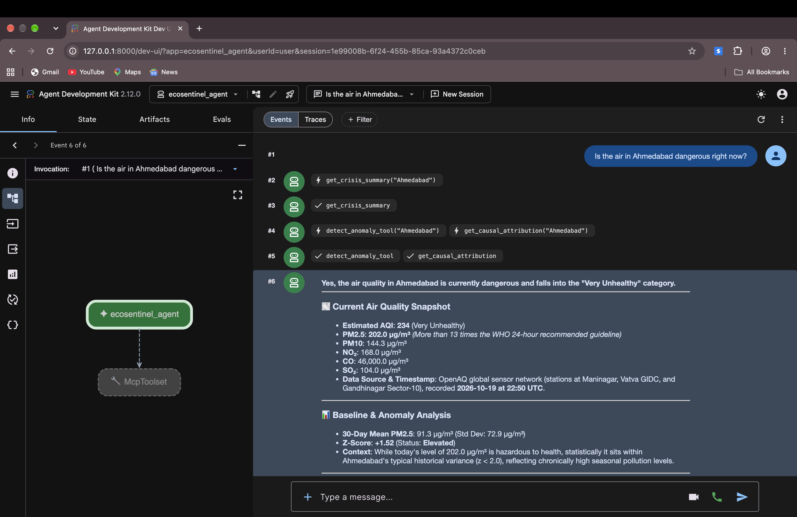

<p align="center"><i>A Gemini agent answering a live question about Ahmedabad. Every number in the answer came from EcoSentinel's tools, not from the model's memory.</i></p>

---

## 👋 What is this?

EcoSentinel is an MCP server that gives AI assistants access to live
environmental data: air quality sensors, satellite wildfire detection, and
weather. On top of that data it does four things a chatbot can't do on its own:

| | Capability | The question it answers | How |
|:---:|---|---|---|
| 📊 | **Detect** | *Is today's pollution unusual for this city?* | Z-score against the city's own 30-day history |
| 🧭 | **Explain** | *Is the wildfire actually causing it, or is it just nearby?* | Causal inference with DoWhy |
| 🔮 | **Predict** | *What will PM2.5 be tomorrow?* | A stacked LSTM trained in PyTorch |
| 📈 | **Track** | *Is the air getting better or worse?* | SQL over sensor history stored in Google BigQuery |

The same server plugs into **two different AI clients without changing a line
of server code**: Claude Desktop, and a Gemini agent built with Google's Agent
Development Kit (ADK).

**Things you can ask:**

> 💬 "Is the air safe to breathe in Delhi today?"
> 💬 "Are there wildfires near Sydney right now?"
> 💬 "Is Jakarta's air quality unusual for this time of year, or just normal smog?"
> 💬 "Is the wildfire actually causing Sydney's pollution, or is it a coincidence?"
> 💬 "What will PM2.5 be in Seoul tomorrow?"
> 💬 "Is Ahmedabad's air getting better or worse this month?"
> 💬 "Give me a full environmental crisis briefing for Mumbai."

---

## 📑 Table of Contents

1. [The Big Idea: Hybrid Intelligence](#-the-big-idea-hybrid-intelligence)
2. [Architecture](#-architecture)
3. [How a Question Gets Answered](#-how-a-question-gets-answered)
4. [MCP in Plain English](#-mcp-in-plain-english)
5. [The Tools](#-the-tools)
6. [Anomaly Detection](#-anomaly-detection)
7. [Causal Inference](#-causal-inference)
8. [LSTM Forecasting](#-lstm-forecasting)
9. [Gemini Agent with Google ADK](#-gemini-agent-with-google-adk)
10. [BigQuery Warehouse on Google Cloud](#-bigquery-warehouse-on-google-cloud)
11. [Getting Started](#-getting-started)
12. [Example Output](#-example-output)
13. [Data Sources](#-data-sources)
14. [Project Structure](#-project-structure)
15. [Running Tests](#-running-tests)
16. [License and Acknowledgements](#-license-and-acknowledgements)

---

## 🧠 The Big Idea: Hybrid Intelligence

Most AI projects let the language model do all the thinking, including the
math. That's a problem, because language models make up numbers.

EcoSentinel splits the work between two kinds of intelligence:

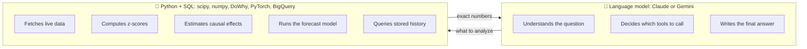

**The model decides *what* to analyze. Python computes *how*.** When there's a
pollution spike near a wildfire, the model doesn't get to guess whether the
fire is to blame. Python runs real statistics and causal inference and hands
the model a number it can defend.

---

## 🧱 Architecture

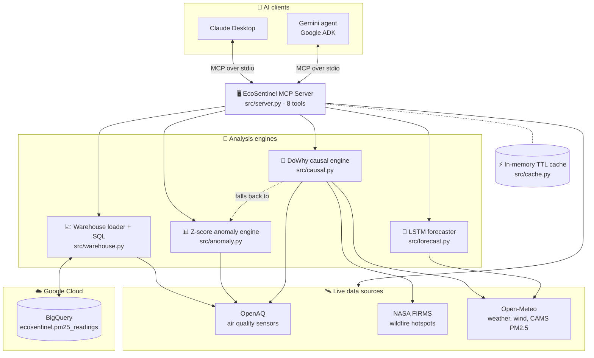

The system is built in layers:

| Layer | Name | Job | Built with |
|:---:|---|---|---|
| 1 | **Data Collection** | Fetch live data from three APIs at the same time, with an in-memory cache | `httpx`, `asyncio.gather`, OpenAQ, NASA FIRMS, Open-Meteo |
| 2 | **Statistical Engine** | Z-score anomaly detection against a 30-day baseline | `scipy`, `numpy` |
| 3 | **Causal Inference** | Estimate `P(Y \| do(X))` to attribute pollution to its cause | `DoWhy`, `pandas` |
| 4 | **Forecasting** | Predict tomorrow's PM2.5 from the last 30 days | `PyTorch` stacked LSTM |
| 5 | **Warehouse** | Store sensor history and answer trend questions with SQL | Google BigQuery, `google-cloud-bigquery`, gcloud CLI |
| 6 | **MCP Interface** | Expose every tool to any MCP-compatible client | `FastMCP`, `mcp` |
| 7 | **AI Clients** | Pick tools and turn results into answers | Claude Desktop, Gemini via Google ADK |

---

## 🔄 How a Question Gets Answered

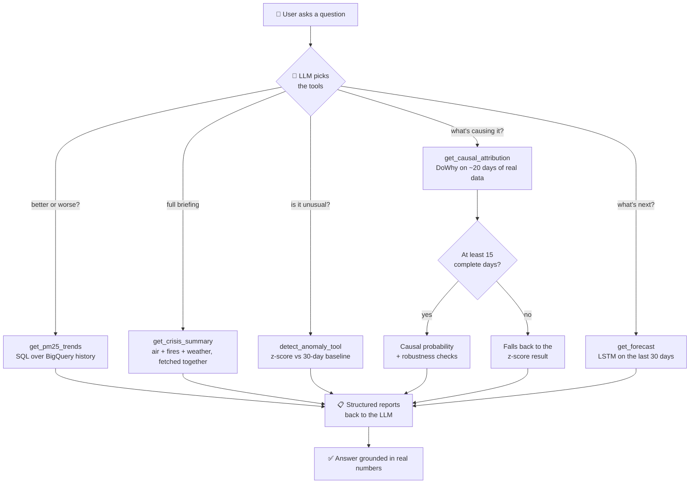

Step by step:

1. 💬 A user asks something like *"What's the air quality in Lagos, and is it normal?"*
2. 🤖 The AI client looks at EcoSentinel's tools and **decides for itself** which ones to call. That's what makes this an agent and not a fixed pipeline.
3. ⚡ For a full briefing, `get_crisis_summary` uses `asyncio.gather()` to fetch air quality, wildfires, and weather **at the same time**, so the wait is about as long as the slowest single call, not all three added together.
4. 📊 `detect_anomaly_tool` compares today's PM2.5 to the city's last 30 days using a **z-score**.
5. 🧭 `get_causal_attribution` builds about 20 days of real paired observations (fire intensity, wind, PM2.5) and uses **DoWhy** to estimate how much of today's PM2.5 the fires actually caused, after accounting for wind.
6. 🛟 If there aren't at least 15 complete days of data, the causal engine **doesn't guess**. It returns the z-score result instead.
7. 🔮 `get_forecast` runs the trained LSTM on the last 30 days to predict tomorrow's PM2.5.
8. 📈 `get_pm25_trends` adds the city's newest readings to BigQuery, then runs SQL for daily averages, the worst and cleanest days, and week-over-week change.
9. 📋 Every tool returns a structured report.
10. ✅ The model writes an answer built entirely on those numbers.

---

## 🔌 MCP in Plain English

**MCP (Model Context Protocol)** is an open standard, created by Anthropic, for
how AI assistants talk to outside tools and data.

Picture a brilliant expert sitting in a room with no internet. MCP is a slot in
the door. You slide a question through, a program on the other side
(`server.py`) looks up the real answer and runs the math, then slides the result
back. That's the difference between *"the AI can only repeat what it learned in
training"* and *"the AI can tell you Mumbai's AQI right now, and whether that's
normal."*

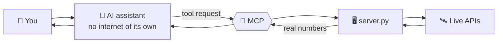

Because MCP is a standard, the server is written once and works with both
Claude Desktop and Google ADK.

---

## 🧰 The Tools

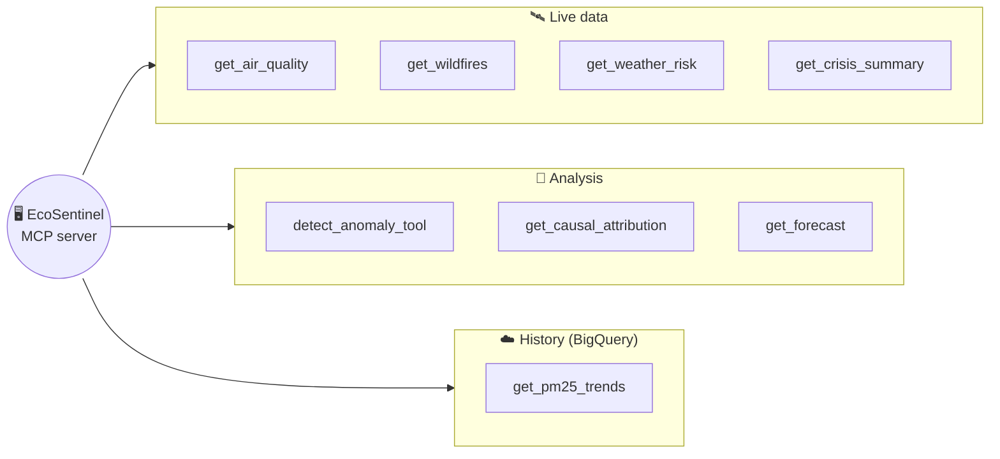

| Tool | Parameters | Source | Status |
|---|---|---|:---:|
| `get_air_quality` | `city` | OpenAQ v3 sensor measurements | ✅ Live |
| `get_wildfires` | `city`, `radius_km`, `days` | NASA FIRMS (VIIRS SNPP) | ✅ Live |
| `get_weather_risk` | `city` | Open-Meteo forecast | ✅ Live |
| `get_crisis_summary` | `city` | All three sources, fetched at the same time | ✅ Live |
| `detect_anomaly_tool` | `city` | OpenAQ history + `scipy` z-score | ✅ Live |
| `get_causal_attribution` | `city` | OpenAQ + NASA FIRMS + Open-Meteo archive + `DoWhy` | ✅ Live |
| `get_forecast` | `city` | Open-Meteo CAMS air quality + weather + trained LSTM | ✅ Live |
| `get_pm25_trends` | `city`, `days` | OpenAQ history stored in Google BigQuery, queried with SQL | ✅ Live |

> 💡 Every tool returns a clean, structured report: AQI calculated from raw
> pollutant readings (only recent ones, each with its measurement time), fire
> hotspots filtered by distance and confidence, and
> flood or storm risk from rainfall and wind-gust thresholds. The AI always
> has real numbers, sources, and timestamps to work with.

---

## 📊 Anomaly Detection

Raw numbers lack context. An AQI of 120 might be an ordinary Tuesday in Delhi
and a real emergency in Sydney. EcoSentinel adds the missing context with a
**z-score** against each city's own 30-day history:

```
z = (today's value - mean) / standard deviation

today's value  →  current PM2.5 reading from OpenAQ
mean           →  average PM2.5 over the last 30 days for this city
std deviation  →  how much PM2.5 normally moves around day to day
```

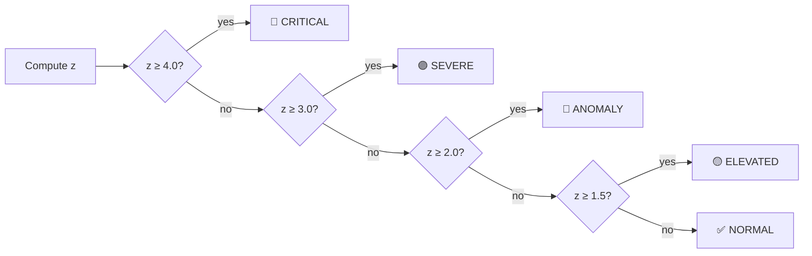

The engine needs at least 10 historical readings. It computes the mean and
standard deviation with `numpy` and `scipy`, works out the z-score, and returns
a structured result (`z_score`, `mean_30day`, `std_30day`, `severity`,
`is_anomaly`, and more) the AI can reason about directly.

### 🔍 Real example: Ahmedabad, 2026-10-19

PM2.5 was **202.0 µg/m³** against a 30-day mean of **91.3** and a standard
deviation of **72.9**. That gives **z = +1.52**:

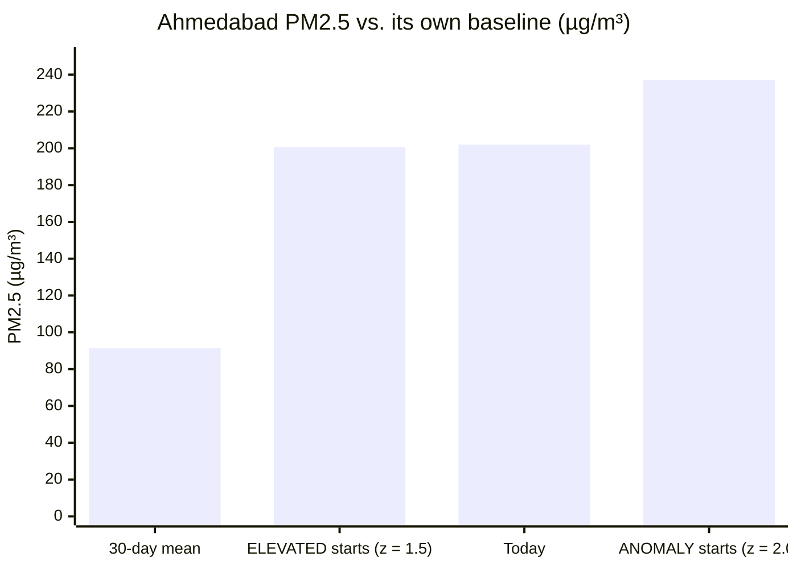

Today's reading just clears the ELEVATED line but stays below the ANOMALY line.
So it's **dangerous to breathe, but not unusual for Ahmedabad**, because the
city's baseline is already high. A plain chatbot can't make that distinction.

---

## 🧭 Causal Inference

### Correlation isn't causation

A wildfire nearby *and* high PM2.5 doesn't prove the fire is the cause. Wind
gets in the way: it affects how smoke travels and also how fast local pollution
clears out. EcoSentinel uses **DoWhy** to pull out the fire's real effect after
accounting for wind.

### The causal graph

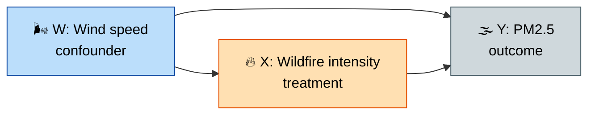

DoWhy reads this graph and estimates:

```
P(Y | do(X)) = the effect of wildfire smoke on PM2.5,
               with the influence of wind (the confounder) removed
```

| Variable | Role | What it is (one value per day) | Source |
|:---:|---|---|---|
| `X` | Treatment | Wildfire intensity: the biggest `brightness / (1 + distance_km)` among that day's hotspots, so closer and hotter fires count more. `0` on days with no fire. | NASA FIRMS |
| `Y` | Outcome | That day's mean PM2.5 | OpenAQ |
| `W` | Confounder | That day's max wind speed (km/h) | Open-Meteo archive |

### How the engine works

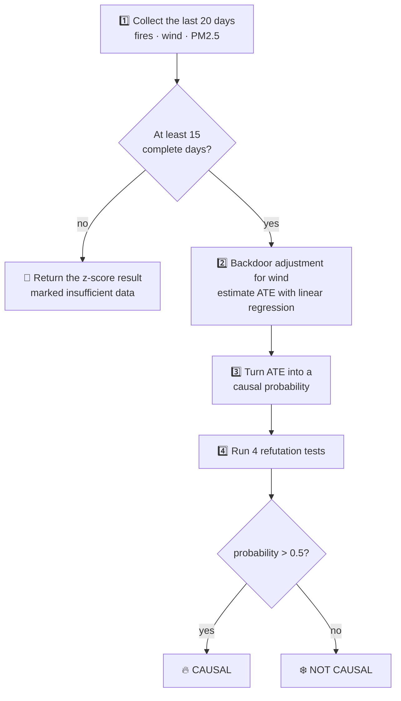

1. **Build a real dataset.** One row per day over the last **20 days**, from real
   observations, not simulated data. It needs at least **15** complete days, or
   it falls back to the z-score result.
2. **Estimate the effect.** DoWhy uses the **backdoor criterion** to adjust for
   wind, then estimates the Average Treatment Effect (ATE) with linear
   regression: *how many µg/m³ of PM2.5 one unit of fire intensity causes*.
3. **Turn it into a probability.**
   ```
   contribution        = ATE × today's fire intensity
   excess              = today's PM2.5 - the 20-day average
   causal_probability  = contribution / excess   (clipped between 0.0 and 1.0)
   ```
   For example, `0.73` means *the fire explains about 73% of today's extra
   PM2.5*. Anything above `0.5` is labelled **CAUSAL**.
4. **Try to break it.** Four DoWhy refutation tests check that the result holds up:

   | Test | What it does | What should happen |
   |---|---|---|
   | Random common cause | Adds a random fake confounder | Effect barely changes |
   | Placebo treatment | Swaps the fire data for random noise | Effect drops to about zero |
   | Data subset | Re-estimates on a random 80% of days | Effect stays stable |
   | Bootstrap | Re-estimates on resampled data | Effect stays stable |

### Observational vs. interventional

- **`P(Y | X)`**: *Given that we see a wildfire*, what's PM2.5? This mixes in all
  kinds of indirect, confounded effects.
- **`P(Y | do(X))`**: *If we forced a wildfire to exist* and held everything else
  fixed, what would PM2.5 be? That's the **true causal effect**.

The result is computed, not guessed by a language model. API calls in the
causal engine also retry with exponential backoff (1s, 2s, 4s), so a slow NASA
FIRMS response doesn't break the analysis.

---

## 🔮 LSTM Forecasting

`get_forecast` predicts **tomorrow's PM2.5** for any city using a stacked LSTM
(a neural network built for sequences) written in PyTorch.

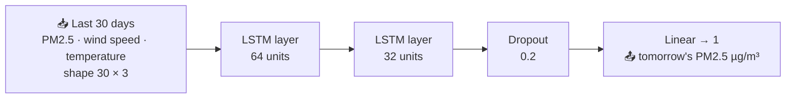

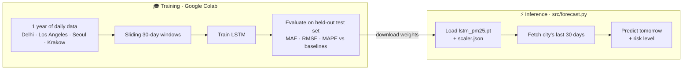

- **Training** happens in Google Colab with
  [`notebooks/EcoSentinel_Phase6_Training.ipynb`](notebooks/EcoSentinel_Phase6_Training.ipynb),
  on 1 year of daily PM2.5 and weather data from Open-Meteo (CAMS) for Delhi,
  Los Angeles, Seoul, and Krakow. Each city is split by time (first 80% of days
  to train, next 10% to validate, last 10% to test), and the notebook scores
  the model against persistence, seasonal-naive, and 7-day rolling-average
  baselines, overall and per city.
- **Inference** in `src/forecast.py` loads the weights (`data/model/lstm_pm25.pt`)
  and scaler (`data/model/scaler.json`), fetches the city's last 30 days, and
  returns the prediction with a risk level.
- 📦 To use `get_forecast`, run the notebook and put `lstm_pm25.pt` and
  `scaler.json` in `data/model/`.

---

## 🤖 Gemini Agent with Google ADK

EcoSentinel's MCP tools also plug straight into a **Gemini agent** built with
Google's [Agent Development Kit (ADK)](https://adk.dev). It took **no changes to
`server.py`**. ADK starts the existing MCP server in the background, asks which
tools it has, and hands all 8 to Gemini.

### What happens when you ask a question

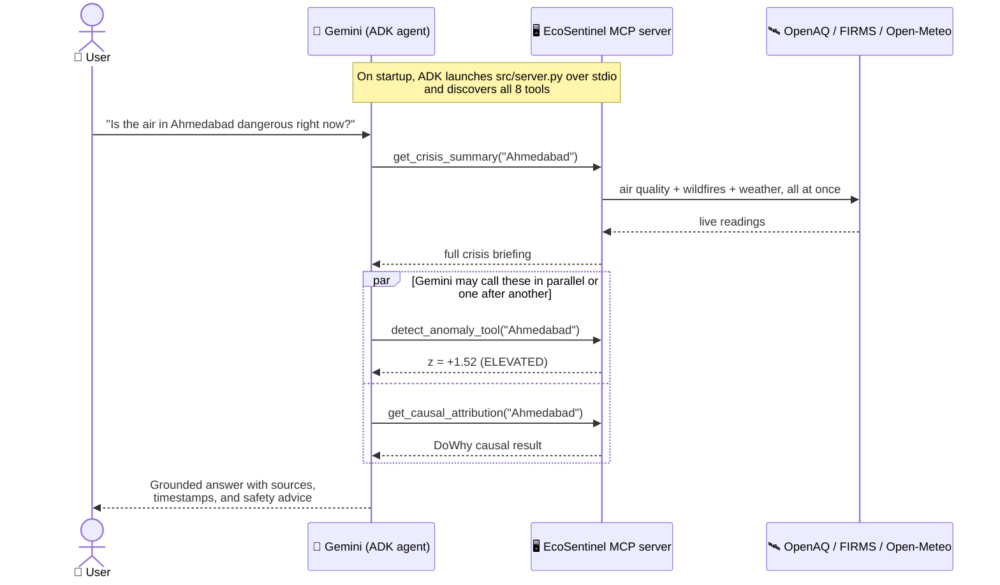

> 🔑 **Gemini never runs the code itself.** It only asks for a tool by name and
> arguments. ADK runs it through MCP and passes the result back.

### The agent fits in one file

[`agents/ecosentinel_agent/agent.py`](agents/ecosentinel_agent/agent.py)
defines a `root_agent` with three parts:

| Part | Value | Why |
|---|---|---|
| 🧠 Model | `gemini-flash-latest` by default, with automatic retries. Set `GEMINI_MODEL` in `.env` to switch (for example to `gemini-flash-lite-latest` when the default is overloaded) | Fast, cheap Gemini models that are good at tool calling |
| 📝 Instruction | EcoSentinel's workflow plus a causal guardrail | Always use tools for current data, check anomaly and causal attribution when PM2.5 is high, use `get_pm25_trends` for history, and never claim fires cause pollution unless `get_causal_attribution` backs it up |
| 🧰 Tools | `McpToolset` → `python src/server.py` over stdio | The exact same MCP server Claude Desktop uses |

### Three design details

| | Detail | Why it matters |
|:---:|---|---|
| 🐍 | The server is launched with `sys.executable` | That's the project's own virtual environment Python, so the server always has DoWhy, PyTorch, and everything else it needs |
| ⏱️ | Connection `timeout=300` seconds | For stdio connections, ADK applies this limit to server startup *and* every tool call. The default of 5s is far too short for loading PyTorch and DoWhy, or for a causal analysis that can take minutes when NASA FIRMS is slow |
| 🔁 | Gemini requests **retry with exponential backoff** | `HttpRetryOptions` allows up to 4 attempts, starting at about 1s and doubling, on temporary errors like `503 UNAVAILABLE` ("model is experiencing high demand") and `429` rate limits. It's the same idea `src/causal.py` uses for NASA FIRMS |

### 📍 Example: Ahmedabad, live run on 2026-10-19

Asked *"Is the air in Ahmedabad dangerous right now?"*, Gemini first called
`get_crisis_summary`, then called `detect_anomaly_tool` and
`get_causal_attribution` in parallel, just as its instruction says. Its answer,
shortened:

> **Yes, Ahmedabad's air is Very Unhealthy (AQI 234).**
> PM2.5 is 202.0 µg/m³ (OpenAQ: Maninagar, Vatva GIDC, Gandhinagar Sector-10).
> Against a 30-day mean of 91.3 µg/m³, the z-score is +1.52 (Elevated): harmful
> to health, but within Ahmedabad's usual range. Calm winds (3.5 km/h) are
> trapping emissions, and NASA FIRMS detected 340 hotspots within 500 km.
> Stay indoors, use an N95 outdoors, and avoid outdoor exercise.

The screenshot at the [top of this README](#-ecosentinel) shows this run.

### 🛡️ Guardrail: no causal claims the causal model didn't make

Looking through that first run's tool responses in the ADK web UI turned up a
problem. `get_causal_attribution` had correctly **declined** to name a cause:

```
⚠️ Only 0 days had complete wildfire + wind + PM2.5 data
   (need at least 15 within the last 20 days).
```

Gemini still wrote that the 340 hotspots were *"adding regional smoke to local
industrial and urban sources."* That's a causal claim based on nothing but a
fire count, the exact correlation-vs-causation mistake the DoWhy engine exists
to prevent.

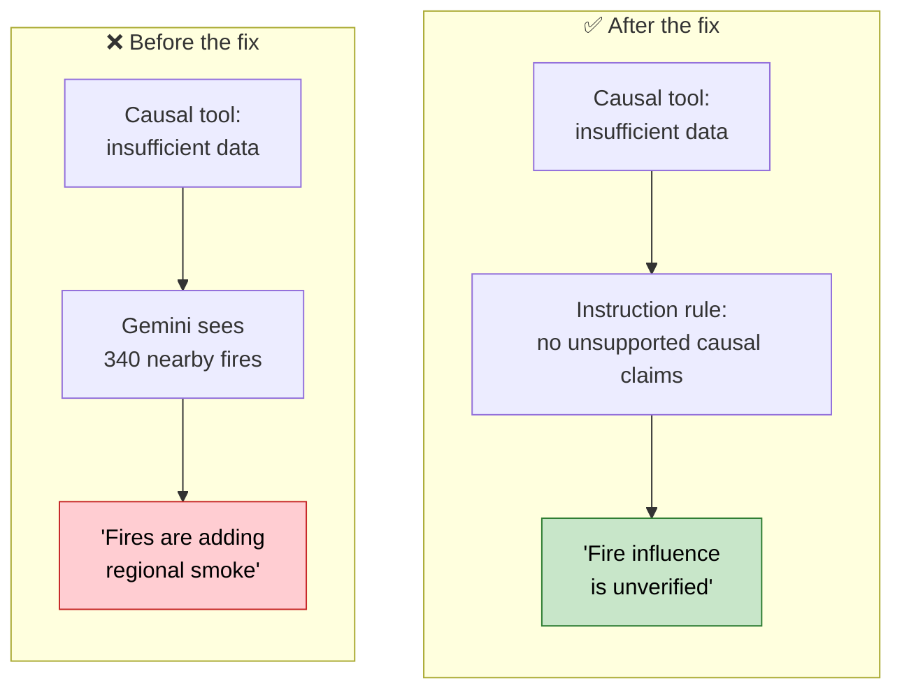

**The fix** was one rule added to the agent's instruction:

```
Only say wildfires are causing or contributing to pollution if
get_causal_attribution returns a causal probability supporting it.
If it reports insufficient data, say fire influence is unverified.
```

**The result** (live run, 2026-10-20). With the same insufficient-data response
from the causal engine, Gemini now reports it honestly:

> NASA FIRMS VIIRS detected 131 hotspots within a 500 km radius over the past
> 48 hours. However, causal attribution analysis indicates insufficient paired
> data, meaning any fire influence on Ahmedabad's current pollution levels is
> **unverified**.

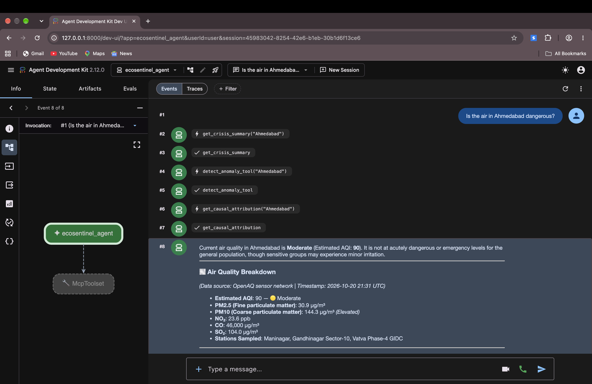

<p align="center"><i>The run after the fix: Gemini calls <code>get_crisis_summary</code>, then <code>detect_anomaly_tool</code>, then <code>get_causal_attribution</code>, and only then answers.</i></p>

---

## 💾 BigQuery Warehouse on Google Cloud

Live APIs answer *"what's the air like now?"* Questions like *"is it getting
better or worse?"* need history. EcoSentinel stores PM2.5 sensor history in
**Google BigQuery**, Google Cloud's data warehouse, and answers trend questions
with SQL through an 8th MCP tool, `get_pm25_trends`. The Gemini agent picked it
up automatically, like every other tool.

### How data flows

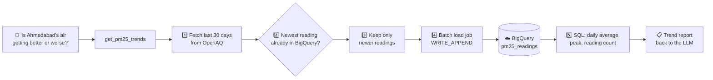

### The table: `ecosentinel.pm25_readings`

One row is one PM2.5 measurement from one sensor at one moment. **Partitioned by
day** on `measured_at`, so a query for the last 30 days only reads those 30
daily chunks, and **clustered by city**, so one city's rows are stored together.

| Column | Type | Meaning |
|---|---|---|
| `city` | STRING | City name, e.g. `Ahmedabad, India` |
| `sensor_id` | INT64 | OpenAQ sensor, so every row traces back to its source |
| `measured_at` | TIMESTAMP | When the sensor took the reading (partition column) |
| `pm25` | FLOAT64 | The reading in µg/m³ |
| `loaded_at` | TIMESTAMP | When EcoSentinel stored it |

### Design decisions

| | Decision | Why |
|:---:|---|---|
| 📅 | **Partitioned by day, clustered by city** | Measured with BigQuery dry runs on the 14-city table: a 7-day trend query scans **76% fewer bytes** than a full-table scan (94,853 vs 390,090 bytes), and a 14-day query 49% fewer. The saving grows as history accumulates |
| 🆓 | Runs in the free **BigQuery sandbox** (no billing account) | The sandbox has no streaming inserts and no DML (`INSERT`, `DELETE`), so rows go in with **batch load jobs** |
| ➕ | **Only new rows are ever loaded** | The sandbox's 10 GiB storage limit is lifetime and *not refunded when data is deleted*, so wiping and reloading would waste it. Running the load twice in a row adds 0 rows |
| 🔐 | **No keys in code** | Authentication uses Application Default Credentials from the `gcloud` CLI (`gcloud auth application-default login`) |
| 🛡️ | **Query parameters** (`@city`, `@days`) | Values are passed separately from the SQL text, never pasted into it, which prevents SQL injection |
| 📏 | **Partial days can't be the "worst day"** | A window edge or sensor outage can leave a day with a few readings. Only days with at least half the median reading count can be named worst or cleanest; partial days still count toward averages, weighted by reading count |
| 🧵 | BigQuery calls run in a **worker thread** | The BigQuery client is synchronous; `asyncio.to_thread` keeps it from freezing the MCP server |

### 📊 What's in the warehouse (2026-10-21)

`scripts/load_cities.py` loaded 30 days of history for 15 cities worldwide.
14 had an active sensor on OpenAQ (Mexico City's nearest sensor had no recent
data):

| | |
|---|---|
| Readings stored | **11,387** |
| Cities | **14** across Asia, Europe, North America, and Australia |
| Duplicate rows | **0**, verified across every sensor and timestamp |
| 7-day query scan savings from partitioning | **76%** |

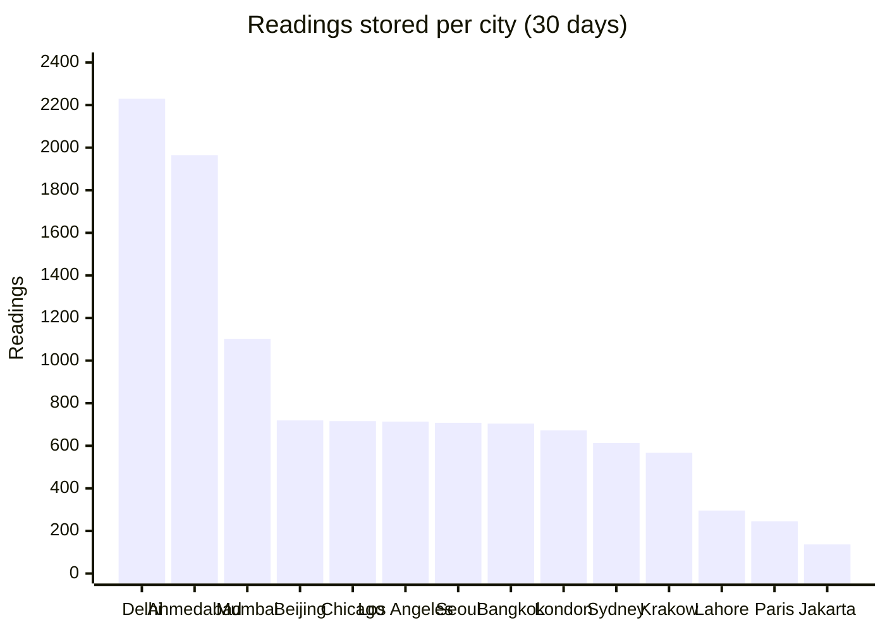

<p align="center"><i>Indian sensors report every 15 minutes (about 96 readings a day); most others report hourly (about 24 a day).</i></p>

### 📍 Example: Ahmedabad, live run on 2026-10-21

The first load stored **1,965 readings** (27 days, one every 15 minutes) for
Ahmedabad's sensor; a second load right after added **0**, and so did the
15-city load later. Asked *"Is
Ahmedabad's air getting better or worse this month?"*, Gemini called only
`get_pm25_trends` and answered from the BigQuery results (shortened):

> Air quality has shown a slight improvement overall. Comparing the latest 7
> days to the previous 7, average PM2.5 decreased from **60.7 to 58.5 µg/m³**
> (about 3.5% better). The 30-day average was 58.9 µg/m³ across 1,965 readings.
> The cleanest day was October 4 (33.9 µg/m³ average); the worst was October 9
> (87.7 µg/m³), with a single peak reading of 357.7 µg/m³ on October 14.

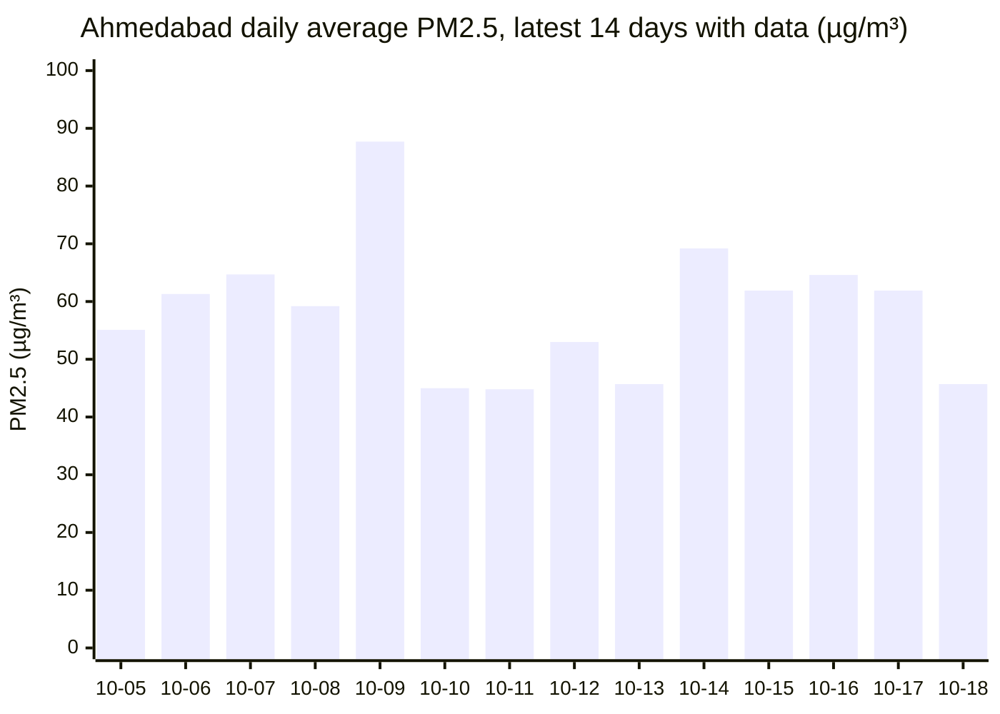

<p align="center"><i>Daily averages straight from the BigQuery query. Oct 18 is a partial day (34 readings) because the station publishes with a delay.</i></p>

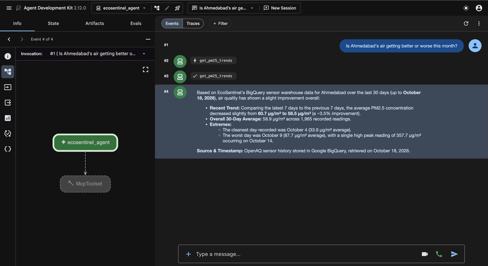

<p align="center"><i>Gemini picks <code>get_pm25_trends</code> on its own and answers entirely from the BigQuery results: week-over-week change, 30-day average, and the cleanest and worst days.</i></p>

---

## 🚀 Getting Started

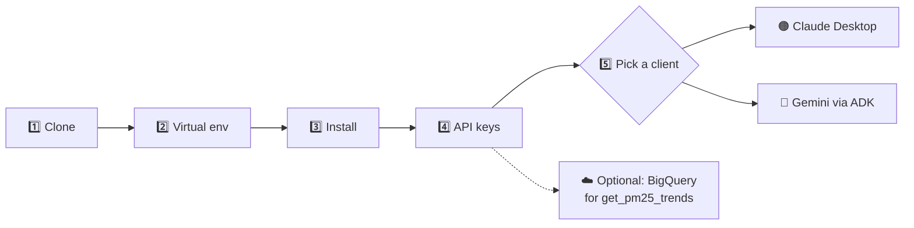

### 1️⃣ Clone the repository

```bash
git clone https://github.com/maahipatel05/ecosentinel.git
cd ecosentinel
```

### 2️⃣ Create a virtual environment

```bash
python -m venv venv
source venv/bin/activate
```

### 3️⃣ Install dependencies

```bash
pip install -r requirements.txt
```

> ⚠️ **Newer macOS:** if importing `scipy` fails with a `dlopen ... zero-fill
> section` error, run `pip install scipy==1.18.1`. DoWhy 0.14 officially pins
> `scipy<=1.15.3`, so `requirements.txt` keeps 1.15.3 and pip will print a
> warning, but all offline tests pass on 1.18.1.

### 4️⃣ Set up your API keys

```bash
cp .env.example .env
```

Then edit `.env`:

| Key | Needed for | Where to get it |
|---|---|---|
| `NASA_FIRMS_API_KEY` | Wildfire data | Free at https://firms.modaps.eosdis.nasa.gov/api/area/ |
| `OPENAQ_API_KEY` | Optional, raises rate limits | OpenAQ and Open-Meteo work without a key |
| `GOOGLE_API_KEY` | The Gemini agent only | Free at https://aistudio.google.com/apikey |
| `GOOGLE_GENAI_USE_VERTEXAI` | The Gemini agent only | Leave as `FALSE`. It tells ADK to use the AI Studio key, not Google Cloud Vertex AI |
| `GEMINI_MODEL` | Optional, the Gemini agent | Defaults to `gemini-flash-latest`. Use `gemini-flash-lite-latest` if the default returns `503` high demand |
| `GCP_PROJECT_ID` | The BigQuery trends tool only | Your Google Cloud project ID (see step 6) |

### 5️⃣ Option A: Connect to Claude Desktop

Add EcoSentinel to your Claude Desktop config at:

```
~/Library/Application Support/Claude/claude_desktop_config.json
```

```json
{
  "mcpServers": {
    "ecosentinel": {
      "command": "python",
      "args": ["/absolute/path/to/ecosentinel/src/server.py"]
    }
  }
}
```

Restart Claude Desktop and EcoSentinel will show up in the tools panel, ready
for questions about anywhere on Earth.

### 5️⃣ Option B: Run the Gemini agent

From the project root, with the virtual environment active:

```bash
adk web agents
```

Open the address it prints (for example `http://127.0.0.1:8000`), pick
**ecosentinel_agent**, and ask a question. Click any tool-call box in the chat
to see exactly what Gemini sent and what EcoSentinel sent back. Press
`Ctrl + C` to stop.

### 6️⃣ Optional: Set up BigQuery for `get_pm25_trends`

Free, with no credit card, using the BigQuery sandbox:

1. Open https://console.cloud.google.com/bigquery, create a project, and copy its
   **Project ID** into `.env` as `GCP_PROJECT_ID`.
2. Install the [gcloud CLI](https://cloud.google.com/sdk/docs/install), then log
   in and point it at your project:
   ```bash
   gcloud auth login
   gcloud config set project YOUR_PROJECT_ID
   gcloud auth application-default login
   gcloud auth application-default set-quota-project YOUR_PROJECT_ID
   ```
3. Check it works:
   ```bash
   bq ls
   ```
   Empty output with no error means you're connected.

The dataset and table are created automatically the first time
`get_pm25_trends` runs. To preload history for 15 cities at once (safe to
re-run, it only adds new readings):

```bash
python scripts/load_cities.py
``` Sandbox tables expire after 60 days, so the tool caps
`days` at 60.

---

## 📋 Example Output

Asking for a crisis summary triggers `get_crisis_summary`, which fetches from
all three sources at once and returns something like:

```
# 🌍 EcoSentinel Crisis Briefing: Jakarta
*Generated: 2026-06-08 14:32 UTC | Powered by EcoSentinel MCP*

---
[Air Quality report: AQI, PM2.5, PM10, NO2, health guidance]
---
[Wildfire report: active hotspots, distance, confidence]
---
[Weather & flood risk report: rainfall, wind, 3-day outlook]
---

## 📋 Summary
Data sources: OpenAQ · NASA FIRMS · Open-Meteo
For emergencies, always contact local authorities.
```

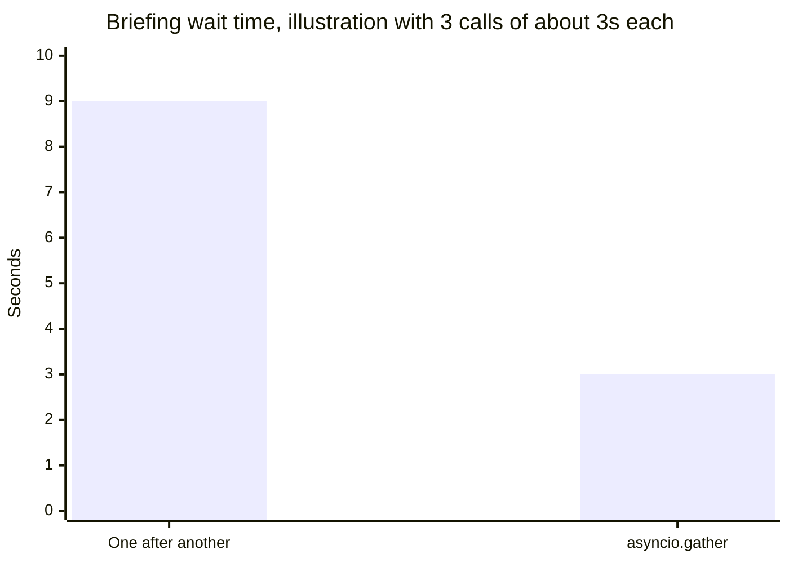

Running the calls together with `asyncio.gather()` means the briefing takes
about as long as one call, roughly 3 seconds instead of 9.

---

## 📡 Data Sources

| Source | What it provides | Used by |
|---|---|---|
| 🌫️ **[OpenAQ](https://openaq.org)** | Real-time and historical readings from ground sensors worldwide (PM2.5, PM10, NO2, CO, O3, SO2) | Air quality, anomaly detection, causal engine |
| 🔥 **[NASA FIRMS](https://firms.modaps.eosdis.nasa.gov)** | Near real-time satellite wildfire detection from the VIIRS SNPP sensor | Wildfires, causal engine |
| 🌦️ **[Open-Meteo](https://open-meteo.com)** | Free weather forecasts, rain, and wind with no API key. Also historical wind (archive API) and CAMS PM2.5 (air quality API) | Weather risk, causal engine, LSTM training and forecasting |

OpenAQ PM2.5 history is also **stored** in Google BigQuery (`ecosentinel.pm25_readings`) for trend queries.

---

## 📁 Project Structure

```
ecosentinel/
├── src/
│   ├── server.py        # MCP server: all 8 tool definitions
│   ├── anomaly.py       # Z-score anomaly detection engine (scipy/numpy)
│   ├── causal.py        # DoWhy causal inference engine: DAG + P(Y|do(X))
│   ├── forecast.py      # LSTM model definition + next-day PM2.5 inference
│   ├── warehouse.py     # BigQuery warehouse: table setup, incremental loads, trend SQL
│   └── cache.py         # In-memory TTL cache for API responses
├── agents/
│   └── ecosentinel_agent/
│       ├── __init__.py  # Lets ADK discover the agent
│       └── agent.py     # Gemini agent wired to the MCP server via McpToolset
├── notebooks/
│   └── EcoSentinel_Phase6_Training.ipynb  # Colab notebook: LSTM training + evaluation
├── data/
│   ├── model/           # scaler.json (+ lstm_pm25.pt, git-ignored)
│   └── eval_results/    # Anomaly-detector evaluation runs (JSON)
├── scripts/
│   ├── load_cities.py   # Loads 30 days of PM2.5 history for 15 cities into BigQuery
│   ├── eval_anomaly.py  # Evaluates the z-score detector against EPA thresholds
│   └── debug_openaq.py  # OpenAQ debugging helper
├── tests/
│   ├── test_tools.py    # Async tests for each live tool (calls real APIs)
│   ├── test_anomaly.py  # Unit tests for the z-score math
│   ├── test_causal.py   # Causal engine tests on synthetic data
│   ├── test_forecast.py # LSTM model + forecast tests
│   ├── test_agent.py    # Gemini agent config + MCP tool discovery (offline)
│   ├── test_openaq.py   # OpenAQ v3 request params, paging, latest readings (offline)
│   └── test_warehouse.py # BigQuery incremental-load and trend-summary logic (offline)
├── docs/
│   └── images/          # README screenshots
├── .env.example         # Template for environment variables
├── requirements.txt     # Python dependencies
├── LICENSE              # MIT license
└── README.md
```

---

## ✅ Running Tests

```bash
# Fast offline tests (anomaly math, causal engine, LSTM, Gemini agent, OpenAQ calls, warehouse): no network needed
python -m pytest tests/ --ignore=tests/test_tools.py -v

# Full suite, including tool tests that call the live APIs
python -m pytest tests/ -v
```

| Test file | What it checks | Needs network? |
|---|---|:---:|
| `test_anomaly.py` | Z-score math, mean, std, and severity thresholds | No |
| `test_causal.py` | DAG building, graceful fallback, probability bounds, strong vs weak signals, refutation output (synthetic data) | No |
| `test_forecast.py` | LSTM shapes, scaling round-trip, risk labels | No |
| `test_agent.py` | Agent model and retry settings, the causal guardrail, and that ADK finds all 8 MCP tools (no Gemini calls) | No |
| `test_openaq.py` | OpenAQ calls use valid v3 parameters, page past 1000 rows, pick a live sensor over a dead one at the same station, report only fresh readings, and hide physically implausible CO values (fake OpenAQ) | No |
| `test_warehouse.py` | Loads add only new, non-duplicate rows; trend summaries weight days by readings, skip partial days for worst/cleanest, and compute week-over-week change | No |
| `test_tools.py` | Air quality, weather risk, and wildfires for real and unknown cities | Yes |

---

## 📜 License and Acknowledgements

MIT. See [LICENSE](LICENSE) for details.

Thanks to:

- **Anthropic** for the Model Context Protocol
- **Google** for the Agent Development Kit, Gemini, and BigQuery
- **OpenAQ** for open, global air quality data
- **NASA FIRMS** for satellite wildfire detection
- **Open-Meteo** for free, no-key weather and air quality data
- **Microsoft DoWhy / PyWhy** for making rigorous causal inference usable in Python
- **PyTorch** for the forecasting model

---

<div align="center">

*Built by [Maahi Patel](https://github.com/maahipatel05), Rice University.*

*For emergencies, always contact local authorities. EcoSentinel is a tool for awareness and research, not a replacement for official alerts.*

</div>
